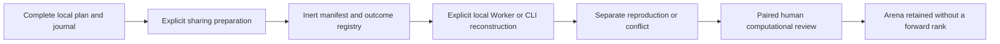

# Sharing programmable forward evidence

This source workflow extends the experiment registry with version-four `PROGRAM_FORWARD_DEMO` records. It is being validated locally; this document does not establish hosted sign-in, public API availability, approved rollout or independently qualified performance. The website remains unpublished at the owner's request.

A programmable forward checkpoint is different from a cold batch replay. It has one persistent guest, original arriving observations, post-computation decisions, interruption history and potentially open positions. Its public evidence must retain those facts rather than turn them into a flat batch score.



## Prepare and publish deliberately

In Programs Session, prepare the complete retained forward evidence after checking its source and sponsor context. This preparation is an inert snapshot: it checks structure and identities, without invoking the guest or publishing anything. Export it before leaving. Planned evidence includes the whole locked Search ledger and forward plan; an unplanned session is explicitly identified by a null plan and cannot claim Search provenance.

Import the complete snapshot in Experiments, review its exact original source, implementation, inputs and disclosures, and provide separate public-sharing consent. Registration freezes an immutable manifest. Its outcome reports the complete original artifact or an explicit interrupted/unavailable disposition. Original request/body/author identity is retained after an uncertain acknowledgement; refresh or a different account cannot replace it with another command.

Every retained Search candidate is a dependency. Public registration requires each exact V2 source to exist as a current public record, including canonical bytes and digest. A source copied from an unregistered local fixture is insufficient. Hiding or withdrawing any dependency suppresses the dependent body on reads, outcomes, reviews, discovery and exports; safe tombstone identity and retained history remain.

The selected source, capital, costs, risk, module and parameters remain unchanged. Source labels, rights, original receipt times and nominal intervals are declarations. Registration time does not prove historical preregistration, valid data rights, provider delivery or unseen custody.

## What the two records contain

`PROGRAM_FORWARD_DEMO_INPUT` retains the complete plan when present, config, original start, method and forward/program/kernel implementation identities. It retains every original outer event and request ID, receipt/completion clock, historical COMPLETED/INTERRUPTED lifecycle directive and unresolved pending admission. Rejected events stay in their original order. A later event prefix is another immutable input and requires another manifest.

Computational claims stay in `PROGRAM_FORWARD_DEMO_ARTIFACT`. Its independent wrapper attempt ID identifies this report without replacing the original session or input IDs. It contains the identical input and whole `LOCAL_PROGRAM_DEMO_SESSION`: original reasons and inner ranges, configure/output/fuel history, raw global bits and memory, failed mutations, original and derived receipts/signals, checkpoints, pending state, account and complete trading journal. No artificial end liquidation or forward batch baseline is added.

A reproduction preserves the original session/input IDs and clocks. Only the wrapper attempt ID and enclosing derived digest are excluded from positive full-semantic equality. Different IDs or sponsors do not establish separate execution or independent research. Keeping outputs separate from the manifest allows a truthful conflicting computation to use the same frozen input.

## Complete size limits

The existing public limits remain unchanged: 192 KiB for input, 512 KiB for an artifact and 576 KiB for an outcome record. Command, manifest and record envelopes must also fit their respective bounds. Forward body depth is explicitly bounded to 40 with finite framing; legacy bodies remain bounded to 16. Every import and server boundary applies its method-specific rules before schema work. Unknown methods, hooks, nonfinite values, sparse arrays and credentials are refused.

Local forward archives can be much larger. The ordinary 48-bar Search example already exceeds the public input limit once every whole attempt is retained. Refuse such material intact and keep its full local archive. Removing losing candidates, state, memory, interruptions or nested reconstructions is not a publication workaround. An ARTIFACT_UNAVAILABLE outcome is useful only under an exact fitting manifest; it does not store a missing complete artifact or replace an oversized manifest.

Use the explicitly separate complete-forward import when inspecting a larger local artifact. The older importer keeps its original pre-read limit. Large local imports do not enlarge public submission allowances.

## Reconstruct locally with consent

Validation first reads and checks the full reported artifact and all current dependencies. After explicit local input-use/execution consent, a module Worker reconstructs from the frozen input with fixed application code. It configures a persistent restricted guest and replays completed original receipts at their recorded clocks. Historical interruption directives remain interruptions. Unresolved pending work is never executed or silently resumed.

Each attempt retains the original full claim, fresh complete or partial reconstruction, differences, failures and cancellation. A forged but coherently self-hashed state may pass inert public admission and still produce a local MISMATCH. A bounded comparison report records complete difference counts and a displayed sample; it is not a replacement for the full original and fresh evidence. Account/source/navigation changes fence late Worker results and dependent exports. A transient final confirmation failure leaves computed adverse evidence held rather than deleting it or releasing an unconfirmed result.

The Linux file-only tool exposes the same separation:

```text
node scripts/program-forward-evidence.mjs snapshot JOURNAL PLAN_OR_- NEW_ARTIFACT
node scripts/program-forward-evidence.mjs compare ARTIFACT NEW_ADMISSION NEW_RESULT
node scripts/program-forward-evidence.mjs recover ADMISSION NEW_RESULT
node scripts/program-forward-evidence.mjs verify ARTIFACT_OR_RESULT
```

Run from the project root. Replace file placeholders with distinct absolute private paths outside the checkout and current working directory; use `-` only for an explicitly unplanned snapshot. Inputs are canonical owner-held mode-0600 files. Outputs are new private files and are not overwritten. The tool checks its fixed source graph, uses guarded local paths and exclusive locks, fsyncs admission before computation and confirms whole output readback. Preserve an uncertain admission or partial file. `recover` records interruption rather than rerunning the admitted operation. Snapshot/verify are inert; compare is explicit local computation. There is no provider request, credential intake, public POST or live-session recovery.

## Reviews and comparison limits

Prepare a paired draft from an original and separate reproduction/conflict, then import it into the existing Experiments review form. The server correlates the two bounded computational reports without replaying the guest. Reviewer grants, current authorization, sponsor separation, exact source/manifest bindings, current-head sequencing, quotas and identical retries remain the existing policy. No default reviewer or agent review authority is installed.

Truthful Search disclosures retain BEST_OBSERVED selection and all declared trials. Existing post-selection and unknown/seen/reused holdout blockers can require HELD even when both reconstructions match. Do not replace those disclosures with FIRST_DECLARED or invented unseen claims. Matching losses, failed computation and interrupted history remain adverse evidence. Reviews are trusted-human computational attestations with qualification NONE and independence NOT_ESTABLISHED.

Arena retains forward members as HELD / FORWARD_PROTOCOL_UNSUPPORTED, with null financial diagnostics, baseline and rank. A forward member prevents ranking of its entire cohort; other members and current adverse review heads remain retained. A suitable forward-ranking method is separate work. A recorded collector archive digest/count does not mean that raw provider responses were publicly retained or authenticated.

## Remaining work

The original batch method still excludes SHORT from selection. [Direction-matched V2](direction-matched-program-search.md) adds a separately frozen policy and complete nested plan; task 033's original actual-clock SHORT Search-to-collector acceptance remains under final validation in task 035. A forward MATCH reconstructs the forward journal, not the earlier Search; use the separate full Search reconstruction for that claim. Authentic licensed observations, unseen custody, independently useful participants, reputation, strategy retention, hosted acceptance, contributor-runner isolation and approved deployment also remain outstanding. Source publication or a computational match grants no financial, merge, deployment or production permission.
